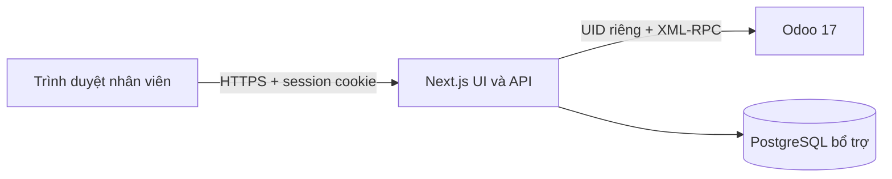

# Kiến trúc và hợp đồng tích hợp

Odoo là nguồn duy nhất của project, task, state, stage, parent/child, chatter và attachment. Mỗi session gắn hash của URL/database và UID; không nhận URL/database/model/method tùy ý từ trình duyệt.

## Mã nguồn

- `src/server/odoo.ts`: version, authenticate, execute_kw, metadata, ORM, fault codes 2/3/4, TLS và proxy môi trường.
- `src/server/auth.ts`, `crypto.ts`, `db.ts`: token ngẫu nhiên 256-bit, chỉ lưu hash; AES-256-GCM với AAD instance/UID; TTL tối đa 24h, thu hồi khi logout.
- `src/server/workspace.ts`: live per-user search, task relations, metadata/state selections, HTML sanitizer, chatter và file access.
- `src/server/mutations.ts`: idempotency key theo instance/UID, fingerprint nội dung, lưu kết quả/unknown; không tự retry upstream.
- `src/app/api/[...path]/route.ts`: API allowlist, validation, Origin/header chống CSRF, chặn ghi theo cấu hình, lỗi có request ID.
- `src/components/workspace.tsx`, `discuss.tsx`: UI tiếng Việt, URL bền vững, polling 30s, draft Chatter scoped theo user/instance, query cache không persist.
- `addons/smart_workspace_bridge`: tùy chọn cho self-hosted/Odoo.sh; khóa bản ghi rồi so revision microsecond trước ORM write. Kiểm tra ACL/record rules, không sudo.

## Tìm kiếm

Danh sách thường dùng ORM domain (`project_id`, `stage_id`, `user_ids`) với phân trang. Tìm kiếm accent-independent đọc trực tiếp từng batch 100 bản ghi theo quyền hiện tại rồi chuẩn hóa Unicode và đ/Đ. Mỗi lượt tối đa 1.000 bản ghi hoặc 40 kết quả, trả `nextCursor`, `scanLimited` và UI Tìm tiếp. Không có cache/chỉ mục dùng chung, không cache mật khẩu trong trình duyệt. Tìm mô tả được bật riêng, không mặc định đọc toàn bộ HTML.

Tên dự án, nhiệm vụ cha và ID luôn nằm trong ngữ cảnh kết quả khi có quyền. Không giả định cây nhiệm vụ cùng dự án. Breadcrumb đọc từng cha theo ACL; dừng khi thiếu quyền, có vòng lặp hoặc vượt 20 mức. Children, siblings, danh sách nhân viên và tài liệu đều có giới hạn; MVP chưa có phân trang riêng cho các tập con này.

## Ghi dữ liệu và đồng bộ

Edit yêu cầu bridge để bảo đảm kiểm tra revision và write trong cùng transaction. Không fallback sang read-then-write không nguyên tử. Bridge chỉ hỗ trợ allowlist trường task. Mọi ACL vẫn do Odoo thực thi.

Create child, message và attachment dùng API công khai. Ledger chống replay cùng key; pending/unknown yêu cầu người dùng kiểm tra dữ liệu trước khi tạo yêu cầu mới. Không hứa exactly-once khi Odoo đã nhận nhưng phản hồi bị mất. Ledger dọn sau 7 ngày; không replay yêu cầu cũ sau cửa sổ đó.

UI không optimistic success; chỉ báo đã lưu sau xác nhận Odoo. Polling và làm mới khi focus cho thay đổi Odoo → app; thao tác ghi app → Odoo trực tiếp. Không có WebSocket, offline queue hoặc đảm bảo realtime. Draft giữ trong tab; logout xóa draft. Form edit giữ trong bộ nhớ khi lỗi, chưa khôi phục qua refresh.

## Bảo mật và giới hạn vận hành

Không ghi arguments XML-RPC/credential/upstream traceback ra log. Lỗi app chỉ ghi code/status/requestId. HTML Odoo qua allowlist; file luôn tải xuống dạng attachment/octet-stream với nosniff, kiểm tra cả task ACL lẫn attachment association. Chưa có antivirus, quota theo tổ chức hoặc DLP; cần bổ sung nếu chính sách doanh nghiệp yêu cầu.

Cookie HttpOnly/SameSite=Lax; production Secure, HTTPS qua reverse proxy. Origin chính xác từ APP_ORIGIN và header riêng bắt buộc trên mutation. ODOO_URL quản trị viên cấu hình, không cho nhân viên nhập URL, không follow arbitrary URLs/attachment links. HTTP chỉ bật rõ ràng cho local test.

Runtime hiện tự khởi tạo schema nếu thiếu; triển khai có DB role tách riêng cần đổi quy trình migration phù hợp. Mỗi session lưu credential đã mã hóa để gọi Odoo bằng danh tính thật; ENCRYPTION_KEY phải được bảo vệ và rotate bằng cách thu hồi phiên. Không SSO/OAuth khi chưa có cấu hình được hỗ trợ.

Mọi tài khoản đã đăng nhập có thể xem trang chẩn đoán **quyền của chính họ**, không thể sửa cấu hình server. Trang này không phải công cụ quản trị hạ tầng. Notification chỉ lấy notification của partner hiện tại và tái kiểm tra task/channel/message ACL; model bị chặn trả trạng thái unavailable. Discuss kiểm tra metadata, ACL và is_member; đọc/gửi qua public ORM và message_post, phân trang/search lịch sử, deep link /discuss/ID?message=ID và kiểm tra association của message. Không dùng private web controller. Tạo/join kênh, trạng thái chưa đọc và tệp Discuss dùng Odoo gốc.

Tài liệu chính thức Odoo 17: [External API](https://www.odoo.com/documentation/17.0/developer/reference/external_api.html), [Web services](https://www.odoo.com/documentation/17.0/developer/howtos/web_services.html), [Project](https://www.odoo.com/documentation/17.0/applications/services/project.html), [Discuss](https://www.odoo.com/documentation/17.0/applications/productivity/discuss.html). Mã tài liệu chính thức nhánh 17.0 đã được đối chiếu; không dùng JSON-2/private web controllers làm hợp đồng ổn định.
